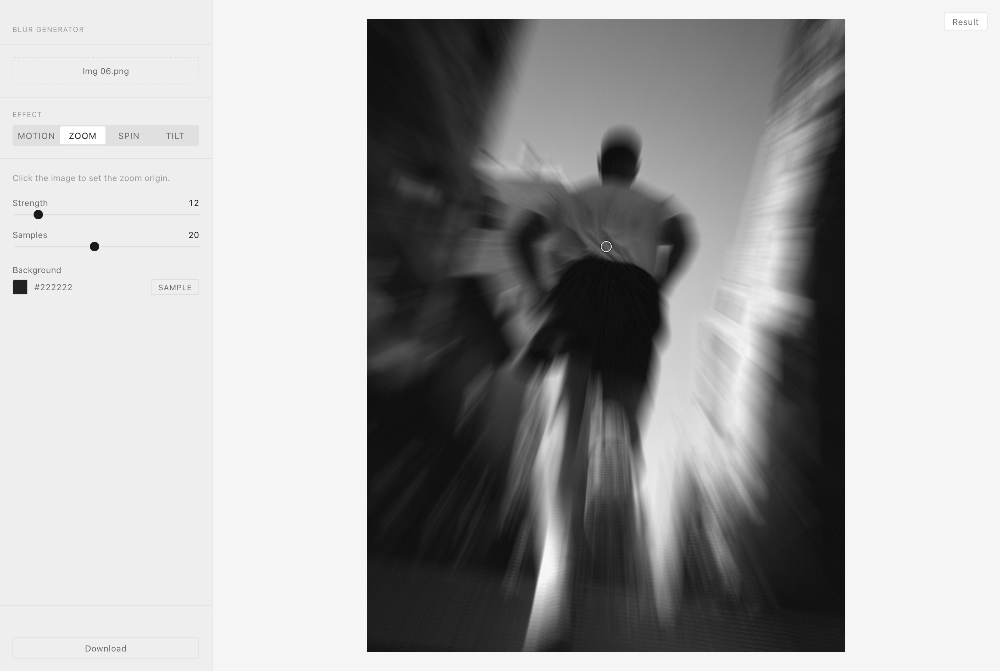

# Blur Generator

Add motion, zoom, spin and tilt-shift blur to your photos, right in the browser.

**Try it:** https://jmackow.github.io/blur-generator/

Images are processed locally with the Canvas API. Nothing is uploaded to a server.



## Effects

| Effect | What it does | Controls |
| --- | --- | --- |
| **Motion** | Linear motion blur in one direction | Angle, strength |
| **Zoom** | Radial blur streaking out from a center point | Click the image to set the center; strength, samples |
| **Spin** | Rotational blur around a center point | Click the image to set the center; angle, samples |
| **Tilt** | Tilt-shift: a sharp horizontal band with blur above and below | Click the image to move the band; focus position, focus width, blur strength |

Motion, zoom and spin can pull in areas beyond the photo's edges. Those areas are filled with a **background** color sampled from the image border, which you can change.

The result updates as you change settings. Use the **Result / Original** toggle to compare, then download the result as a JPEG. Images larger than 3000 px on the long side are scaled down before processing.

Want something to try it on? Sample photos are in [`example-assets/`](example-assets).

## Run it locally

You need [Node.js](https://nodejs.org/) 18, 20, or 22 or newer. Node comes with npm.

```bash
git clone https://github.com/jmackow/blur-generator.git
cd blur-generator
npm install
npm run dev
```

Then open the address it prints, usually http://localhost:5173.

### Scripts

| Command | What it does |
| --- | --- |
| `npm run dev` | Start the dev server with hot reload |
| `npm run build` | Type-check and build static files into `dist/` |
| `npm run preview` | Serve the `dist/` build locally |

The build is a plain static site, so you can host `dist/` anywhere.

## Browser support

Recent versions of Chrome, Edge, Firefox and Safari (16.4 or newer). The app relies on `OffscreenCanvas`.

## Project structure

```
src/
  blurEffects.ts   The blur algorithms (framework-free canvas code)
  App.tsx          Layout and state
  components/      Upload, effect picker, sliders, image viewer
  types.ts         Effect and parameter types
example-assets/    Sample photos to try the effects on
docs/              README screenshot
```

Built with [React](https://react.dev/), [TypeScript](https://www.typescriptlang.org/) and [Vite](https://vite.dev/).

## Contributing

Issues and pull requests are welcome. Before opening a pull request, check that `npm run build` passes. CI runs the same check on every pull request.

## License

[MIT](LICENSE) © Jarosław Maćków
